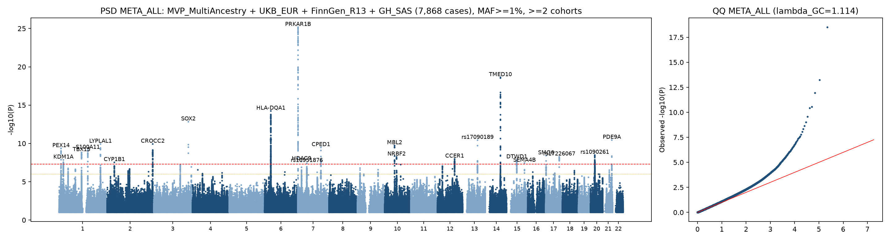
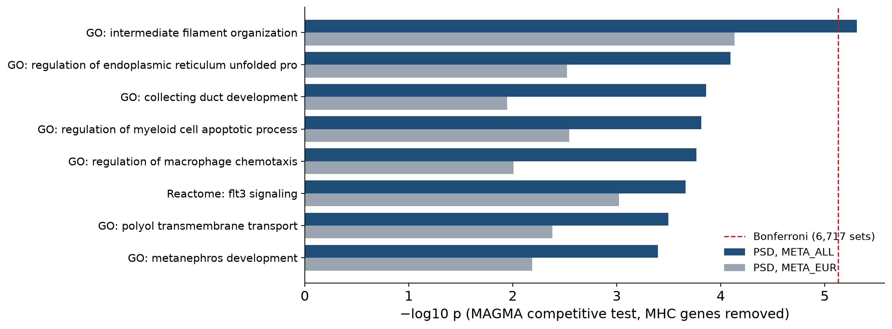
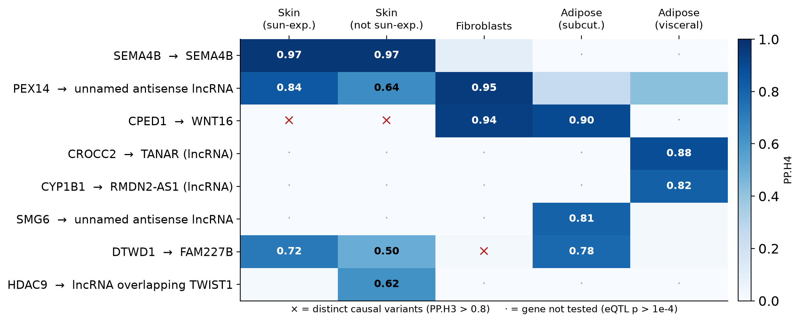
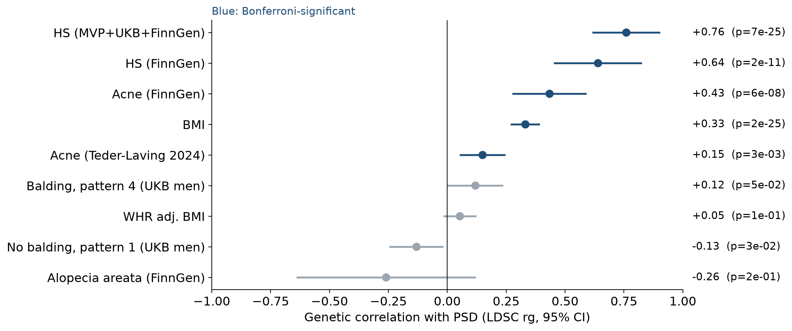
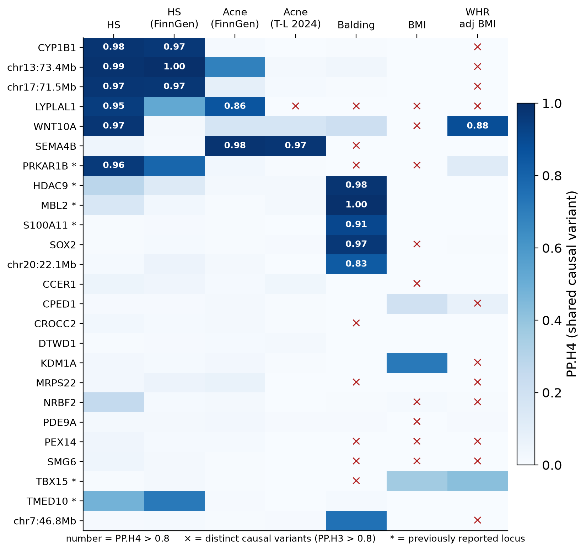
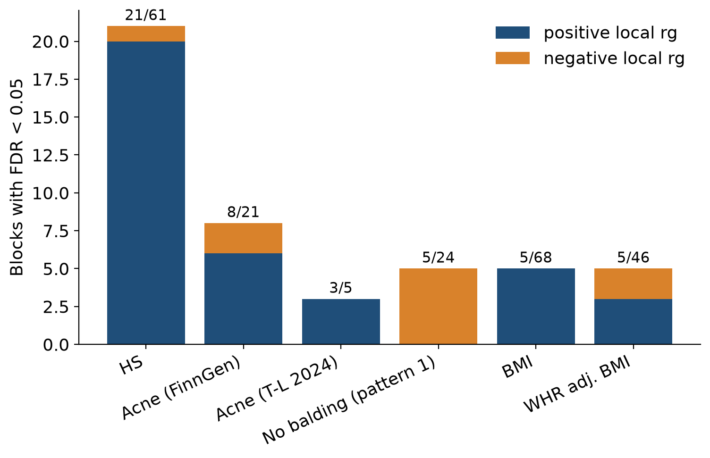

## Pilonidal sinus disease (PSD) {.smaller}

::: {.columns}
::: {.column width="62%"}
- Chronic inflammation of the natal cleft: hair-filled sinus tracts and recurrent abscesses
- Incidence 26 per 100,000; 2.2× more common in men; presents around age 20; family history in 38% [@sondenaa1995]
- Acquired-disease model: hair insertion causes the sinus and its recurrence [@karydakis1992]; overweight, local trauma and sedentary work are common [@sondenaa1995]
- Recurrence depends on surgical technique and follow-up: < 1% at 2 years after flap or Karydakis/Bascom repair, up to 68% at 20 years after midline closure [@stauffer2018]
- Positive family history: earlier onset and more long-term recurrence (52% vs 28% at 25 years) [@doll2009], so the disease is partly **heritable**
:::
::: {.column width="38%"}
::: {.callout-note appearance="simple"}
### Follicular occlusion tetrad
PSD is grouped with **hidradenitis suppurativa (HS)**, acne conglobata and dissecting cellulitis of the scalp [@vasanth2014]

Shared feature: follicular occlusion and rupture
:::
:::
:::

## What was known about PSD genetics {.smaller}

| Study | Design | Loci |
|---|---|---|
| @roberson2024 | GWAS, UKB + FinnGen + Penn Medicine (2,835 cases, European only) | 5 loci: *HDAC9/TWIST1*, *TBX15/WARS2*, *PRKAR1B*, *NEK9/EIF2B2/GPATCH2L*, *RP11-293M10.1*. Also rg with male-pattern baldness and rare *TCHH* variants (OR 4.8) |
| FinnGen R12 [@kurki2023] | Single biobank (Open Targets credible sets) | *DKK1/MBL2*, *TCHH* (epidermal differentiation complex), chr1:27 Mb |
| UK Biobank WGS [@ukbwgs2025] | Rare-variant credible sets (public summary statistics) | *CHRM3*, *RNFT2* |
| @klein2025 | Focused UKB dermatology GWAS | *TTK* (rare coding) |

<br>

**Gaps**

- European ancestry only; at most 2,835 cases
- No comparison with HS or acne, and no locus-level test of the hair and body-shape links
- No gene- or pathway-level interpretation of the polygenic signal

## Aims

<br>

1. **Discover** PSD risk loci with a multi-biobank, multi-ancestry meta-GWAS and fine-map them
2. **Partition** what PSD shares with HS, acne, balding and body shape, both genome-wide and locus by locus
3. **Prioritise** candidate effector genes and test which pathways carry the polygenic signal

## Data: PSD summary statistics {.smaller}

| Cohort | Ancestry | Cases | Controls | Source |
|---|---|---:|---:|---|
| Million Veteran Program [@verma2024] | EUR + AFR + AMR | 2,073 | 629,531 | GCST90480439 |
| ↳ MVP, European subset (EUR meta only) | EUR | 1,433 | 448,820 | GCST90478766 |
| UK Biobank, WGS [@ukbwgs2025] | EUR | 1,466 | 456,974 | GCST90473908 |
| FinnGen R13 [@kurki2023] | FIN | 3,872 | 468,418 | L12_PILONIDALCYST |
| Genes & Health, exome [@kim2026; @finer2020] | SAS | 457 | 43,569 | GCST90727025 |
| **META_ALL** | all | **7,868** | **1.6 M** | |
| **META_EUR** | EUR + FIN | **6,771** | **1.37 M** | |

- All public summary statistics: GWAS Catalog [@sollis2023] and FinnGen public release
- About 2.8× the cases of the previous largest PSD GWAS

## Data: comparator traits {.smaller}

- **HS**: MVP + UKB + FinnGen, EUR + AFR (3,941 cases) [@peacker2026]; FinnGen R13 (1,453 cases)
- **Acne**: FinnGen R13 (4,812 cases); @tederlaving2024 (34,422 cases)
- **Balding**: UKB men, hair pattern 1 [@jiang2021] and pattern 4 (Neale lab UKB GWAS)
- **BMI, WHR adj. BMI**: GIANT + UKB [@pulit2019]
- **Alopecia areata**: FinnGen R13
- **eQTL**: GTEx v8 skin, fibroblasts and adipose tissue, via the eQTL Catalogue [@kerimov2021; @gtex2020]

## Methods {.smaller}

::: {.columns}
::: {.column width="33%"}
### 1 · Discovery
- Harmonize to GRCh38 (all coordinates in this talk are GRCh38); MAF ≥ 1%; multi-allelic sites removed; variant present in ≥ 2 cohorts
- Fixed-effect inverse-variance meta-analysis in METAL [@willer2010]
- Distinct loci (±500 kb), labeled known or novel against prior articles
- LDSC intercept correction [@bulik2015ldsc]
- Leave-FinnGen-out check; random effects at heterogeneous loci
- Fine-mapping: ABF [@wakefield2009] + SuSiE-RSS with UK Biobank LD [@zou2022]
:::
::: {.column width="33%"}
### 2 · Shared genetics
- Genome-wide: LDSC rg
- Joint model: Genomic SEM
- Local: LAVA, ~1 Mb blocks
- Variant: coloc
- How much of the signal is shared with HS, acne, balding and adiposity?
:::
::: {.column width="33%"}
### 3 · Genes and pathways
- eQTL coloc with GTEx v8 skin, fat and fibroblasts [@kerimov2021; @gtex2020]
- Locus-to-gene scoring
- Gene-level scores: MAGMA [@deleeuw2015]
- Gene sets: 6,717 GO BP and Reactome sets, MHC genes removed, Bonferroni
:::
:::

<br>

::: {.callout-important appearance="simple"}
The **MHC** (chr6:25–34 Mb) is excluded from locus counts, colocalization, LAVA and gene sets, because its long-range LD inflates every gene-level method.
:::

## Result 1: 25 risk loci, 19 novel {.smaller}

{width="100%"}

- **25 genome-wide significant loci outside the MHC: 6 known, 19 novel.** None of the 19 reaches significance in any single cohort.
- LDSC intercept 1.05 (ratio 0.25), so inflation is mostly polygenicity. 21 loci (15 novel) survive intercept correction.
- Not driven by one biobank: every novel locus keeps its direction with p < 0.05 in MVP + UKB alone.
- SNP heritability (liability scale) 13–15%; rg between biobanks 0.83 (MVP vs FinnGen).

::: {.notes}
**LDSC (LD score regression)**

- Variants in big LD blocks tag many neighbours, so under polygenicity they show stronger association on average. Bias (e.g. population structure) inflates all variants equally, regardless of LD.
- Regress association strength on LD score: the **slope** gives heritability, the **intercept** gives bias (1 = none).
- Here: intercept 1.05, ratio 0.25 → about 3/4 of the inflation is real polygenic signal. h² 13–15% on the liability scale.
:::

## Fine-mapping highlights {.smaller}

| Locus | Top variant | PIP ABF | PIP SuSiE | Comment |
|---|---|---:|---:|---|
| *SOX2* | rs1345417 | 1.00 | 0.99 | One-variant credible set |
| *PDE9A* | rs111363985 | 0.90–0.98 | 0.92 | |
| chr13:73.4 Mb (*KLF5*) | rs17090189 | 0.65–0.81 | 0.79 | Same lead variant as HS |
| *WNT10A* | rs121908120 (p.Phe228Ile) | 0.45–0.57 | 0.73 | Protective missense, OR 0.54^†^ |

<br>

- Hair-follicle development genes lie near several loci: *SOX2*, *SOX9*, *WNT10A*, *DKK1*, *TWIST1*, *TBX15*

<small>^†^ Suggestive after LDSC-intercept correction. ABF: META_EUR and META_ALL. SuSiE-RSS: META_EUR with UK Biobank European LD, with LD-mismatch diagnostics.</small>

::: {.notes}
**Fine-mapping**

- A GWAS hit is a tower of correlated SNPs; fine-mapping uses their LD pattern to find which one best explains the tower.
- **PIP** (posterior inclusion probability) = the probability that a variant is the causal one. 0.97 → almost certainly this SNP; 0.02 → one of many candidates.
- **Credible set** = the smallest group of variants that together contain the causal one with 95% probability. Small set = resolved locus.
- Caveat: SuSiE needs the sample's LD; we used UK Biobank European LD matrices, which approximate a mostly European meta-analysis but not exactly.
:::

## Result 2: shared genetics with other traits {.smaller}

| Trait | Genome-wide rg<br><small>LDSC</small> | Joint model β<br><small>Genomic SEM</small> | Local rg, ~1 Mb blocks<br><small>LAVA, FDR < 0.05</small> | Same causal variant<br><small>coloc, PP.H4 > 0.8</small> |
|---|---|---|---|---|
| **HS** | **0.76** (0.54 without cohort overlap) | **0.75** (p = 1×10⁻⁸) | **21 / 61** blocks, 20 positive | **6 loci**, incl. *KLF5* and *SOX9* regions |
| **Balding** | weak; risk goes with balding | **−0.25** for no-balding (p = 1×10⁻⁵) | 5 / 24, all risk ↔ balding | 5 loci: *HDAC9*, *DKK1/MBL2*, *TCHH*, *SOX2*, chr20:22.1 Mb |
| **Acne** | 0.15–0.43 | n.s. | 11 / 26, 9 positive | *SEMA4B*, *LYPLAL1* |
| **BMI** | 0.33 | 0.01 (p = 0.89) | 5 / 68; ≈ 0 in 15 / 16 HS-shared blocks | 0 shared; 9 loci with **different** variants |
| WHR adj. BMI | n.s. | n.s. | 5 / 46, mixed signs | 1 shared (*WNT10A*); 12 different |

<br>

- Each column zooms in: whole genome → joint model of all traits → ~1 Mb blocks → single variants
- **HS is the main partner at every scale**; the BMI link disappears once HS is in the model, and obesity loci carry different variants
- A separate **hair-patterning** axis: PSD risk goes with balding genome-wide and locally; 5 shared variants (same direction at 3) [@roberson2024]

<small>Details in backup slides. PSD META_EUR; MHC excluded. Joint models: PSD ~ HS + BMI, and PSD ~ HS + acne + BMI + WHR + balding.</small>

::: {.notes}
**Four methods, four scales: same question, does PSD share genetics with this trait?**

- **LDSC rg**: whole genome. Do variants that raise PSD risk also tend to raise the other trait's risk?
- **Genomic SEM**: a multiple regression on genetic liability. Holding HS constant, is anything left linking PSD to BMI? (No: β 0.01.) It has no location.
- **LAVA**: splits the genome into ~1 Mb blocks and estimates the correlation in each block, with direction. It uses all variants in the block and needs no significant hit, but doesn't show that it's the same variant.
- **coloc**: one locus. Is it the same causal variant for both traits (H4), or two different nearby variants (H3)? It needs a strong signal in both traits and assumes one causal variant per trait.
- They agree: HS is the main partner everywhere; for BMI there's no shared liability beyond HS, no local correlation, and different variants at overlapping loci.
:::

## Result 3: gene sets (MAGMA, MHC-free) {.smaller}

{width="85%" fig-align="center"}

- One set passes Bonferroni across 6,717: **intermediate filament organisation** (74 genes, p = 5×10⁻⁶, p~Bonf~ = 0.03, META_ALL)
- Driven by *TCHH* and hair and inner root sheath keratins (*KRT31*, *KRT35*, *KRT36*, *KRT40*, *KRT71*), none genome-wide significant; holds without the *TCHH* region (p = 3×10⁻⁵)
- Same direction in META_EUR (p = 7×10⁻⁵, not significant); not associated with HS, acne or BMI (p > 0.6)
- **No immune pathway enriched outside the MHC**

## Result 4: gene expression (eQTL colocalization) {.smaller}

{width="78%" fig-align="center"}

- 25 loci × 5 GTEx v8 tissues from the eQTL Catalogue [@kerimov2021; @gtex2020]; 6 loci share a causal variant with at least one gene
- ***SEMA4B***: the PSD risk allele **raises *SEMA4B* expression in skin** (PP.H4 0.97, resolved to one SNP, rs34560261). The same SNP is the likely causal acne variant [@petridis2018].
- ***CPED1* → *WNT16***: the risk allele raises *WNT16* in fibroblasts and fat; in skin, a different variant drives *WNT16*
- No eQTL support for the developmental genes (*SOX2*, *SOX9*, *TBX15*, *DKK1*, *KLF5*): adult bulk tissue misses developmental regulation

::: {.notes}
**eQTL colocalization**

- An eQTL is a variant that changes how much of a gene is made in a tissue (GTEx: skin, fibroblasts, fat).
- coloc asks whether the variant behind the PSD signal is the same one that changes the gene's expression (PP.H4 ≥ 0.8).
- If so, it points to the gene and to a direction: the risk allele raises or lowers its expression.
- Adult bulk tissue misses genes that act during development, so the absence of an eQTL doesn't rule out a gene.
:::

## Locus-to-gene: which genes are supported? {.smaller}

| Strongest evidence | Loci | Prioritised gene(s) |
|---|---:|---|
| Coding variant (PIP ≥ 0.1) or eQTL coloc, protein-coding gene | 3 | ***SEMA4B***^‡^ (skin eQTL) · ***WNT16*** at *CPED1* (fibroblast eQTL) · ***WNT10A***^‡^ (p.Phe228Ile) |
| eQTL coloc with a lncRNA only | 4 | *CROCC2* (TANAR) · *PEX14* (antisense) · *SMG6* (antisense) · *CYP1B1*^‡^ (RMDN2-AS1) |
| Two or more weaker lines | 8 | *PRKAR1B* · *TMED10* · *SOX2* · *TCHH* · *TBX15* · *FAM227B* · *KDM1A* · *HDAC9* |
| One line (mostly proximity) | 10 | *PDE9A* · *LYPLAL1* · *DKK1*/*MBL2* · *NRBF2* · *CCER1* · *MRPS22*^‡^ · gene deserts: *SOX9*, *KLF12*^†^, *PAX1*, *TNS3* |

<br>

- Gene score: nearest (+1), top MAGMA gene (+1), coding variant in the credible set (+1/+2), eQTL coloc (+1/+2), Open Targets L2G (+1). Functional evidence for a protein-coding gene outranks proximity.
- **Only 3 of 25 loci have a functional effector gene.** The developmental genes (*SOX2*, *SOX9*, *DKK1*) rest on proximity plus locus-level sharing with balding or HS.
- 4 loci are gene deserts (nearest gene 250–600 kb away): their targets need developmental or skin-specific regulatory data.

<small>^†^ chr13:73.4 Mb: the nearest protein-coding gene is *KLF12* (254 kb); "*KLF5* region" follows the HS GWAS naming [@sun2023]. ^‡^ p = 5–8×10⁻⁸ after LDSC-intercept correction (suggestive).</small>

::: {.notes}
**How a candidate effector gene is defined**

- **Functional evidence** = a protein-changing variant with PIP ≥ 0.1, or an eQTL coloc with PP.H4 ≥ 0.8.
- A protein-coding gene with functional evidence wins the locus. Otherwise genes are scored on nearest, top MAGMA gene, coding variant, eQTL and Open Targets L2G, and the highest score wins.
- It's a transparent heuristic in the spirit of Open Targets L2G, not a published standard.
- lncRNA loci: the coloc partner is a non-coding RNA. Only *TANAR* and *RMDN2-AS1* have official names; the *PEX14* and *SMG6* ones are unnamed antisense transcripts. A lncRNA eQTL may also mark an enhancer acting on its neighbour gene.
:::

## Functional interpretation: two genetic axes {.smaller}

::: {.columns}
::: {.column width="50%"}
### Hair (shared with balding)
- *SOX2* marks the dermal papilla cells that set hair-follicle type [@driskell2009]
- *WNT10A*: the protective allele (p.Phe228Ile, OR 0.54) is a known ectodermal-dysplasia allele (ClinVar 4462); loss of *WNT10A* gives sparse hair [@adaimy2007]
- *TCHH* builds the hair shaft; its mutations cause uncombable hair [@basmanav2016]. Hair-shaft and inner root sheath keratins are enriched genome-wide
- *DKK1* is induced by androgens in balding dermal papilla [@kwack2008]; *HDAC9/TWIST1* is a balding locus [@roberson2024], where the PSD risk allele raises a skin lncRNA overlapping *TWIST1* (suggestive eQTL coloc)

**→ Inherited hair-shaft and follicle traits, partly androgen-driven, may make hairs likelier to penetrate the natal cleft [@karydakis1992]. This could help explain the male excess.**
:::
::: {.column width="50%"}
### Follicular epithelium (shared with HS and acne)
- *KLF5* region: the **same lead SNP (rs17090189) as the HS GWAS** [@sun2023]
- *SOX9* region: an HS locus [@sun2023]; *SOX9* builds the outer root sheath and hair stem-cell niche [@vidal2005]
- *SEMA4B* and *WNT10A* are acne loci; the *SEMA4B* causal variant sits in a p63 binding site [@petridis2018]
- *WNT16* drives keratinocyte proliferation [@teh2007]

**→ The PSD–HS–acne overlap points to the pilosebaceous epithelium, giving a genetic basis for "follicular occlusion".**
:::
:::

::: {.notes}
**TWIST1 thread (suggestive only)**

- At the *HDAC9* locus, the PSD risk allele raises an unnamed lncRNA (ENSG00000232821) that overlaps *TWIST1*, in non-sun-exposed skin. PP.H4 0.62 (EUR) / 0.75 (ALL), below our 0.8 cut-off.
- At the *CROCC2* locus, the coloc partner is *TANAR*, "TWIST1-associated lncRNA regulated by androgen receptor". The name comes from a single kidney-cancer study (Oncogene 2021): androgen receptor induces *TANAR*, which affects *TWIST1* RNA decay. The coloc is in visceral fat (PP.H4 0.88 EUR / 0.92 ALL).
- *TWIST1* is a dermal papilla transcription factor, so this fits the hair/androgen axis, but the evidence is thin: one cancer cell-line study and one sub-threshold coloc.
:::

## A working model {.smaller}

```{mermaid}
flowchart LR
  G["PSD genetic<br/>liability"] --> H["Hair traits<br/>SOX2 · WNT10A · TCHH<br/>DKK1 · HDAC9/TWIST1"]
  G --> F["Follicular epithelium<br/>SOX9 · KLF5 · SEMA4B<br/>WNT16 · PRKAR1B"]
  H --> I["Hair insertion<br/>in the natal cleft"]
  F --> O["Follicular occlusion<br/>and rupture"]
  I --> S["Sinus tract"]
  O --> S
  S --> X["Secondary inflammation<br/>and infection"]
  B["Higher BMI"] -. "via HS-shared<br/>liability" .-> F
```

- Hair axis: shared with balding, PSD-specific relative to HS. Epithelial axis: shared with HS and acne.
- Outside the MHC, no immune pathway is enriched: consistent with inflammation being secondary, although genetic data cannot establish the order of events
- Testable predictions: hair-shaft properties by genotype; *SEMA4B*, *KLF5* and *SOX9* enhancer activity in follicular keratinocytes

## Summary

1. **Largest PSD GWAS to date** (5 cohorts, 4 ancestry groups): 25 loci, 19 novel, including several hair-follicle development genes
2. PSD shares **most of its common-variant liability with HS** (rg 0.76), plus specific causal variants with HS (*KLF5*, *SOX9* regions) and acne (*SEMA4B*)
3. The **obesity link is explained by the HS-shared liability**; obesity loci carry different variants
4. A distinct **hair-patterning** axis: the balding link [@roberson2024] is pinned to specific shared variants (*HDAC9*, *DKK1*, *TCHH*, *SOX2*)
5. Candidate effector genes: *SEMA4B* (skin), *WNT16* (fibroblasts) and *WNT10A* (missense); hair-shaft keratin genes enriched genome-wide

## Limitations and next steps {.smaller}

::: {.columns}
::: {.column width="50%"}
**Limitations**

- About 86% of cases are of European ancestry
- The HS comparator shares cohorts with PSD. This is handled with LDSC intercepts, and the non-overlap rg is 0.54.
- ICD-code phenotypes
- LD-reference mismatch in fine-mapping
- Between-cohort heterogeneity at 4 loci (*DKK1/MBL2*, *TCHH*, *KDM1A*, *HDAC9*; I² 67–81%); random effects as sensitivity analysis
- 19 novel loci reach significance only in the meta-analysis
- No fully independent replication cohort yet
:::
::: {.column width="50%"}
**Next steps**

- coloc-SuSiE at multi-signal loci (*PEX14*, *SEMA4B*)
- Manuscript submission (EJHG)
:::
:::

## References {.smaller .scrollable}

::: {#refs}
:::

# Backup {.unnumbered}

## Backup: PSD is genetically closest to HS {.smaller}

{width="88%" fig-align="center"}

- HS rg = 0.76, and 0.54 when the cohorts don't overlap (MVP PSD vs FinnGen HS)
- Acne 0.15–0.43 · BMI 0.33 · PSD risk tracks balding (weak; first reported by @roberson2024) · WHR adj. BMI and alopecia areata not significant

## Backup: Genomic SEM: HS explains the BMI link

<br>

| Model | Result |
|---|---|
| PSD ~ HS + BMI | HS **β = 0.75** (p = 1×10⁻⁸) · BMI β = 0.01 (p = 0.89) |
| PSD ~ HS + acne + BMI + WHR + balding | HS **0.73** · no-balding **−0.25** (p = 1×10⁻⁵) · others not significant |
| Common factor (PSD, HS, acne) | PSD loading **0.94**; residual variance 0.12 (SE 0.26) |

<br>

- PSD's genetic link to BMI runs **through the liability it shares with HS**, not through obesity itself
- A separate **hair-patterning** component remains: PSD risk goes with balding
- Most of PSD's common-variant liability is a follicular-occlusion factor

## Backup: shared causal variants (colocalization) {.smaller}

::: {.columns}
::: {.column width="52%"}
{height="600"}
:::
::: {.column width="48%"}
- **HS**: 6 PSD loci share a causal variant, including the *KLF5* region, a known HS locus [@peacker2026]. Three of the six also colocalize with the FinnGen-only HS GWAS (a subset of the main HS GWAS, not an independent replication).
- **Acne**: *SEMA4B*, *LYPLAL1*
- **Balding**: *HDAC9*, *DKK1/MBL2*, *S100A11/TCHH*, *SOX2*, chr20:22.1 Mb. The PSD risk allele goes with more balding at *HDAC9*, *TCHH* and chr20:22.1 Mb, and with less at *DKK1/MBL2* and *SOX2*.
- **BMI / WHR**: overlapping loci carry **different** causal variants (×). *LYPLAL1* shares with HS and acne but not with fat distribution.

<small>coloc.abf, ±500 kb, p₁₂ = 5×10⁻⁶; shared = PP.H4 > 0.8</small>
:::
:::

## Backup: LAVA: local genetic correlation {.smaller}

::: {.columns}
::: {.column width="58%"}
{width="100%"}
:::
::: {.column width="42%"}
- 101 LD blocks with PSD signal, 225 bivariate tests (MHC excluded)
- **HS**: 21 of 61 blocks significant, 20 of them positive. This is the same locus set coloc finds.
- **No balding**: all 5 significant blocks are negative, so PSD risk goes with balding.
- **BMI** local rg is ≈ 0 in 15 of 16 HS-shared blocks.
- WHR adj. BMI: mixed signs, including *TBX15*.

<small>FDR < 0.05 (Benjamini–Hochberg)</small>
:::
:::
