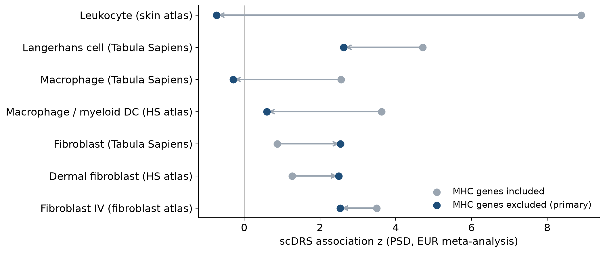

## Pilonidal sinus disease (PSD) {.smaller}

::: {.columns}
::: {.column width="62%"}
- Chronic inflammation of the natal cleft: hair-filled sinus tracts and recurrent abscesses
- Incidence 26 per 100,000; 2.2× more common in men; presents around age 20; family history in 38% [@sondenaa1995]
- Acquired-disease model: hair insertion causes the sinus and its recurrence [@karydakis1992]; overweight, local trauma and sedentary work are common [@sondenaa1995]
- Recurrence depends on surgical technique and follow-up: < 1% at 2 years after flap or Karydakis/Bascom repair, up to 68% at 20 years after midline closure [@stauffer2018]
- Positive family history: earlier onset and more long-term recurrence (52% vs 28% at 25 years) [@doll2009], so the disease is partly **heritable**
:::
::: {.column width="38%"}
::: {.callout-note appearance="simple"}
### Follicular occlusion tetrad
PSD is grouped with **hidradenitis suppurativa (HS)**, acne conglobata and dissecting cellulitis of the scalp [@vasanth2014]

Shared feature: follicular occlusion and rupture
:::
:::
:::

## What was known about PSD genetics {.smaller}

| Study | Design | Loci |
|---|---|---|
| @roberson2024 | GWAS, UKB + FinnGen + Penn Medicine (2,835 cases, European only) | 5 loci: *HDAC9/TWIST1*, *TBX15/WARS2*, *PRKAR1B*, *NEK9/EIF2B2/GPATCH2L*, *RP11-293M10.1*. Also rg with male-pattern baldness and rare *TCHH* variants (OR 4.8) |
| FinnGen R12 [@kurki2023] | Single biobank (Open Targets credible sets) | *DKK1/MBL2*, *TCHH* (epidermal differentiation complex), chr1:27 Mb |
| UK Biobank WGS [@ukbwgs2025] | Rare-variant credible sets (public summary statistics) | *CHRM3*, *RNFT2* |
| @klein2025 | Focused UKB dermatology GWAS | *TTK* (rare coding) |

<br>

**Gaps**

- European ancestry only; at most 2,835 cases
- No comparison with HS or acne, and no locus-level test of the hair and body-shape links
- No cell-type mapping of the polygenic signal

## Aims

<br>

1. **Discover** PSD risk loci with a multi-biobank, multi-ancestry meta-GWAS and fine-map them
2. **Partition** what PSD shares with HS, acne, balding and body shape, both genome-wide and locus by locus
3. **Map** the polygenic signal onto skin and hair-follicle cell types

## Data: PSD summary statistics {.smaller}

| Cohort | Ancestry | Cases | Controls | Source |
|---|---|---:|---:|---|
| Million Veteran Program [@verma2024] | EUR + AFR + AMR | 2,073 | 629,531 | GCST90480439 |
| ↳ MVP, European subset (EUR meta only) | EUR | 1,433 | 448,820 | GCST90478766 |
| UK Biobank, WGS [@ukbwgs2025] | EUR | 1,466 | 456,974 | GCST90473908 |
| FinnGen R13 [@kurki2023] | FIN | 3,872 | 468,418 | L12_PILONIDALCYST |
| Genes & Health, exome [@kim2026; @finer2020] | SAS | 457 | 43,569 | GCST90727025 |
| **META_ALL** | all | **7,868** | **1.6 M** | |
| **META_EUR** | EUR + FIN | **6,771** | **1.37 M** | |

- All public summary statistics: GWAS Catalog [@sollis2023] and FinnGen public release
- About 2.8× the cases of the previous largest PSD GWAS

## Data: comparator traits and single-cell atlases {.smaller}

::: {.columns}
::: {.column width="50%"}
**Comparator GWAS**

- **HS**: MVP + UKB + FinnGen, EUR + AFR (3,941 cases) [@peacker2026]; FinnGen R13 (1,453 cases)
- **Acne**: FinnGen R13 (4,812 cases); @tederlaving2024 (34,422 cases)
- **Balding**: UKB men, hair pattern 1 [@jiang2021] and pattern 4 (Neale lab UKB GWAS)
- **BMI, WHR adj. BMI**: GIANT + UKB [@pulit2019]
- **Alopecia areata**: FinnGen R13
:::
::: {.column width="50%"}
**Single-cell RNA-seq (7 atlases)**

- Tabula Sapiens skin, 17,786 cells [@tabulasapiens2022]
- CELLxGENE skin atlases [@cellxgene2025]:
  - 12-dataset dermis + epidermis (15,243 cells)
  - Keratinocytes (9,471 cells)
  - Fibroblasts (2,303 cells)
  - Scalp, trunk and foreskin (68,036 cells)
- HS lesions + healthy skin, GSE274880 [@kashyap2024]
- Hair-follicle mesenchyme: dermal papilla, dermal sheath cup and upper dermal sheath (GSE287304)
:::
:::

## Methods {.smaller}

::: {.columns}
::: {.column width="33%"}
### 1 · Discovery
- Harmonize to GRCh38; MAF ≥ 1%; variant present in ≥ 2 cohorts
- Fixed-effect inverse-variance meta-analysis [@willer2010]
- Distinct loci (±500 kb), labeled known or novel against prior art
- LDSC intercept correction [@bulik2015ldsc]
- Leave-FinnGen-out check
- Fine-mapping: ABF [@wakefield2009] + SuSiE-RSS [@zou2022]
:::
::: {.column width="33%"}
### 2 · Shared genetics
- Genome-wide rg: LDSC [@bulik2015rg]
- Multivariable model: Genomic SEM [@grotzinger2019]
- Shared causal variant at each locus: coloc [@giambartolomei2014; @wallace2020]
- Local rg in LD blocks: LAVA [@werme2022]
:::
::: {.column width="33%"}
### 3 · Genes and cells
- Gene-level scores: MAGMA [@deleeuw2015]
- Top 1,000 genes, z-weighted
- scDRS on 7 atlases, 1,000 control gene sets [@zhang2022]
- Balding as a positive control
- eQTL coloc with GTEx v8 skin, fat and fibroblasts [@kerimov2021; @gtex2020]
:::
:::

<br>

::: {.callout-important appearance="simple"}
The **MHC** (chr6:28–34 Mb) is excluded from locus counts, colocalization, LAVA and gene sets, because its long-range LD inflates every gene-level method.
:::

## Result 1: 25 risk loci, 19 novel {.smaller}

{width="100%"}

- **25 genome-wide significant loci outside the MHC: 6 known, 19 novel.** None of the 19 reaches significance in any single cohort.
- LDSC intercept 1.05 (ratio 0.25), so inflation is mostly polygenicity. 21 loci (15 novel) survive intercept correction.
- Not driven by one biobank: every novel locus keeps its direction with p < 0.05 in MVP + UKB alone.
- SNP heritability (liability scale) 13–15%; rg between biobanks 0.83 (MVP vs FinnGen).

## Fine-mapping highlights {.smaller}

| Locus | Top variant | PIP | Comment |
|---|---|---:|---|
| *SOX2* | rs1345417 | 0.97–1.00 | Single-variant credible set; dermal papilla transcription factor |
| *PEX14 / KIF1B* | rs140563213 | 0.99 | One of 3 independent signals |
| *PDE9A* | rs111363985 | 0.92–0.98 | |
| chr17:71.5 Mb (*SOX9* desert) | rs714894 | 0.94 | Shared with HS |
| *TMED10 / NEK9* | rs8013918 | 0.84 | Known locus |
| chr13:73.4 Mb (near *KLF5*) | rs17090189 | 0.65–0.81 | Shared with HS |
| *WNT10A* | rs121908120, p.Phe228Ile | 0.74 | Protective missense (OR 0.54); ectodermal-dysplasia gene^†^ |

<br>

- Hair-follicle development genes recur: *SOX2*, *SOX9*, *WNT10A*, *DKK1*, *TWIST1*, *TBX15*
- Caveat: the 1000 Genomes LD reference does not match the sample LD (SuSiE s = 0.04–0.19), so treat credible sets as indicative

^†^ Suggestive after LDSC-intercept correction

## Result 2: PSD is genetically closest to HS {.smaller}

{width="88%" fig-align="center"}

- HS rg = 0.76, and 0.54 when the cohorts don't overlap (MVP PSD vs FinnGen HS)
- Acne 0.15–0.43 · BMI 0.33 · PSD risk tracks balding (weak; first reported by @roberson2024) · WHR adj. BMI and alopecia areata not significant

## Genomic SEM: HS explains the BMI link

<br>

| Model | Result |
|---|---|
| PSD ~ HS + BMI | HS **β = 0.75** (p = 1×10⁻⁸) · BMI β = 0.01 (p = 0.89) |
| PSD ~ HS + acne + BMI + WHR + balding | HS **0.73** · no-balding **−0.25** (p = 1×10⁻⁵) · others not significant |
| Common factor (PSD, HS, acne) | PSD loading **0.94**; residual variance 0.13 (SE 0.26) |

<br>

- PSD's genetic link to BMI runs **through the liability it shares with HS**, not through obesity itself
- A separate **hair-patterning** component remains: PSD risk goes with balding
- Most of PSD's common-variant liability is a follicular-occlusion factor

## Result 3: shared causal variants (colocalization) {.smaller}

::: {.columns}
::: {.column width="52%"}
{height="600"}
:::
::: {.column width="48%"}
- **HS**: 6 PSD loci share a causal variant, including the *KLF5* region, a known HS locus [@peacker2026]. Three of the six replicate with the independent FinnGen HS GWAS.
- **Acne**: *SEMA4B*, *LYPLAL1*
- **Balding**: *HDAC9*, *DKK1/MBL2*, *S100A11/TCHH*, *SOX2*, chr20:22.1 Mb. The PSD risk allele goes with more balding.
- **BMI / WHR**: overlapping loci carry **different** causal variants (×). *LYPLAL1* shares with HS and acne but not with fat distribution.

<small>coloc.abf, ±500 kb, p₁₂ = 5×10⁻⁶; shared = PP.H4 > 0.8</small>
:::
:::

## LAVA: local genetic correlation {.smaller}

::: {.columns}
::: {.column width="58%"}
{width="100%"}
:::
::: {.column width="42%"}
- 101 LD blocks with PSD signal, 225 bivariate tests (MHC excluded)
- **HS**: 21 of 61 blocks significant, 20 of them positive. This is the same locus set coloc finds.
- **No balding**: all 5 significant blocks are negative, so PSD risk goes with balding.
- **BMI** local rg is ≈ 0 in 15 of 16 HS-shared blocks.
- WHR adj. BMI: mixed signs, including *TBX15*.

<small>FDR < 0.05 (Benjamini–Hochberg)</small>
:::
:::

## Result 4: cell types (scDRS) {.smaller}

{width="78%" fig-align="center"}

- With the MHC, 15–17 immune groups reach FDR < 0.05, but this is driven by 63 HLA genes from a single locus
- **Without the MHC: 0 groups (EUR) / 1 group (ALL: Fibroblast IV, FDR 0.04)**. Fibroblast IV resembles NGFR⁺ Schwann-like F5 fibroblasts [@steele2025]
- Positive control works: balding maps to the dermal papilla (z = 7.0)
- **Conclusion:** weak but consistent fibroblast enrichment; no robust cell-type signal

## Result 5: gene expression (eQTL colocalization) {.smaller}

{width="78%" fig-align="center"}

- 25 loci × 5 GTEx v8 tissues from the eQTL Catalogue [@kerimov2021; @gtex2020]; 7 loci share a causal variant with at least one gene
- ***SEMA4B***: the PSD risk allele **raises *SEMA4B* expression in skin** (PP.H4 0.97, resolved to one SNP, rs34560261). The same SNP leads the acne colocalization.
- ***CPED1* → *WNT16***: the risk allele raises *WNT16* in fibroblasts and fat; in skin, a different variant drives *WNT16*
- No eQTL support for the developmental genes (*SOX2*, *SOX9*, *TBX15*, *DKK1*, *KLF5*): adult bulk tissue misses developmental regulation

## Functional interpretation: two genetic axes {.smaller}

::: {.columns}
::: {.column width="50%"}
### Hair (shared with balding)
- *SOX2* marks the dermal papilla cells that set hair-follicle type [@driskell2009]
- *WNT10A*: the protective allele (p.Phe228Ile, OR 0.54) is a known ectodermal-dysplasia allele (ClinVar 4462); loss of *WNT10A* gives sparse hair [@adaimy2007]
- *TCHH* builds the hair shaft; its mutations cause uncombable hair [@basmanav2016]
- *DKK1* is induced by androgens in balding dermal papilla [@kwack2008]; *HDAC9/TWIST1* is a balding locus [@roberson2024]

**→ Inherited hair-shaft and follicle traits, partly androgen-driven, may make hairs likelier to penetrate the natal cleft [@karydakis1992]. This could help explain the male excess.**
:::
::: {.column width="50%"}
### Follicular epithelium (shared with HS and acne)
- *KLF5* region: the **same lead SNP (rs17090189) as the HS GWAS** [@sun2023]
- *SOX9* region: an HS locus [@sun2023]; *SOX9* builds the outer root sheath and hair stem-cell niche [@vidal2005]
- *SEMA4B* and *WNT10A* are acne loci; the *SEMA4B* causal variant sits in a p63 binding site [@petridis2018]
- *WNT16* drives keratinocyte proliferation [@teh2007]

**→ The PSD–HS–acne overlap points to the pilosebaceous epithelium, giving a genetic basis for "follicular occlusion".**
:::
:::

## A working model {.smaller}

```{mermaid}
flowchart LR
  G["PSD genetic<br/>liability"] --> H["Hair traits<br/>SOX2 · WNT10A · TCHH<br/>DKK1 · HDAC9/TWIST1"]
  G --> F["Follicular epithelium<br/>SOX9 · KLF5 · SEMA4B<br/>WNT16 · PRKAR1B"]
  H --> I["Hair insertion<br/>in the natal cleft"]
  F --> O["Follicular occlusion<br/>and rupture"]
  I --> S["Sinus tract"]
  O --> S
  S --> X["Secondary inflammation<br/>and infection"]
  B["Higher BMI"] -. "via HS-shared<br/>liability" .-> F
```

- Hair axis: shared with balding, PSD-specific relative to HS. Epithelial axis: shared with HS and acne.
- No polygenic immune signal beyond HLA class II, so inflammation is more likely a consequence than the trigger
- Testable predictions: hair-shaft properties by genotype; *SEMA4B*, *KLF5* and *SOX9* enhancer activity in follicular keratinocytes

## Summary

1. **Largest and first multi-ancestry PSD GWAS**: 25 loci, 19 novel, enriched for hair-follicle development genes
2. PSD shares **most of its common-variant liability with HS** (rg 0.76), plus specific causal variants with HS (*KLF5*, *SOX9* regions) and acne (*SEMA4B*)
3. The **obesity link is mediated by HS-shared liability**; obesity loci carry different variants
4. A distinct **hair-patterning** axis: the balding link [@roberson2024] is pinned to specific shared variants (*HDAC9*, *DKK1*, *TCHH*, *SOX2*)
5. Best-supported effector genes: *SEMA4B* (skin) and *WNT16* (fibroblasts); no robust cell-type signal once the MHC is removed

## Limitations and next steps {.smaller}

::: {.columns}
::: {.column width="50%"}
**Limitations**

- About 86% of cases are of European ancestry
- The HS comparator shares cohorts with PSD. This is handled with LDSC intercepts, and the non-overlap rg is 0.54.
- ICD-code phenotypes
- LD-reference mismatch in fine-mapping
- No fully independent replication cohort yet
:::
::: {.column width="50%"}
**Next steps**

- coloc-SuSiE at multi-signal loci (*PEX14*, *SEMA4B*)
- Manuscript
:::
:::

## References {.smaller .scrollable}

::: {#refs}
:::
